# Введение

Объект исследования — сайт онлайн-школы **CodeLab**, разработанный в лабораторной работе №2. Оптимизированная версия и два варианта для A/B-теста опубликованы на GitHub Pages:

- Исходная версия «до» (лаб. 2): [https://arsenfatkhullin21.github.io/webdesign-lab2/](https://arsenfatkhullin21.github.io/webdesign-lab2/)
- Оптимизированная версия, **вариант A**: [https://arsenfatkhullin21.github.io/webdesign-lab3/](https://arsenfatkhullin21.github.io/webdesign-lab3/)
- **Вариант B**: [https://arsenfatkhullin21.github.io/webdesign-lab3/b/](https://arsenfatkhullin21.github.io/webdesign-lab3/b/)
- Исходный код: [https://github.com/ArsenFatkhullin21/webdesign-lab3](https://github.com/ArsenFatkhullin21/webdesign-lab3)

Обе версии размещены на одном хостинге (GitHub Pages, CDN), поэтому сравнение «до / после» корректно. Замеры PageSpeed Insights и Lighthouse выполнены 1 ноября 2026 года.

# 1. Цель работы

1. Освоить методику юзабилити-тестирования веб-интерфейсов.
2. Научиться измерять метрики Core Web Vitals (LCP, INP, CLS) в бесплатных инструментах.
3. Изучить методы A/B-тестирования и статистической оценки результатов.
4. Получить практические навыки анализа поведения пользователей через тепловые карты и записи сессий.
5. Понять принципы data-driven дизайна: как данные влияют на дизайнерские решения.

# 2. Подготовка исследования

## 2.1. Гипотезы

Таблица: Гипотезы исследования {#tab:hyp}

| № | Гипотеза | Как проверяется |
|---|---|---|
| H1 | Главная страница на мобильной сети загружается медленнее порога «хорошо» (LCP > 2.5 с). Причина — цепочка блокирующих запросов (5 CSS-файлов и Google Fonts), а не тяжёлые изображения. | PageSpeed Insights, Lighthouse, диаграмма загрузки — до и после оптимизации |
| H2 | Основная кнопка в Hero «Выбрать курс» не воспринимается как путь к записи: часть пользователей выбирает «Бесплатная консультация» или ищет запись в меню. | Clarity (клики), сценарий 1 юзабилити-теста |
| H3 | Формулировка с выгодой и зелёный цвет («Начать бесплатно») увеличат число кликов по главной кнопке и сократят время до клика по сравнению с синей кнопкой «Выбрать курс». | A/B-тест |

## 2.2. Метрики

Таблица: Метрики исследования {#tab:metrics}

| Тип | Метрики | Инструмент |
|---|---|---|
| Производительность | LCP, INP (лабораторный аналог — TBT), CLS, FCP, Speed Index, время загрузки | PageSpeed Insights, Lighthouse |
| Поведенческие | время выполнения задачи, доля успеха, ошибки, глубина скролла | протокол тестирования, Clarity |
| Субъективные | SUS, оценка лёгкости поиска (1–5) | Google Forms |
| Конверсионные | клики по CTA, время до клика, rage clicks | Clarity, скрипт `js/ab.js` |

## 2.3. Аудитория

Портрет участника: 18–35 лет, пользуется интернетом ежедневно, рассматривает онлайн-обучение. Устройство — ноутбук или смартфон. С сайтом CodeLab участник ранее не знаком. Для юзабилити-теста — 5 участников; столько достаточно, чтобы выявить около 80% проблем.

Таблица: Участники юзабилити-тестирования {#tab:participants}

{{include:_gen/participants.md}}

# 3. Замер и оптимизация Core Web Vitals

## 3.1. Исходное состояние: PageSpeed Insights

PageSpeed Insights запускает Lighthouse на серверах Google. Он эмулирует Moto G Power и медленную сеть 4G (рисунки @fig:psi-bm, @fig:psi-bd).

Полевых данных (Chrome UX Report) для сайта нет: у учебного сайта недостаточно реального трафика. Поэтому **INP** оценивается по лабораторному аналогу — Total Blocking Time (TBT = 0 мс, длинных задач нет).

::: row
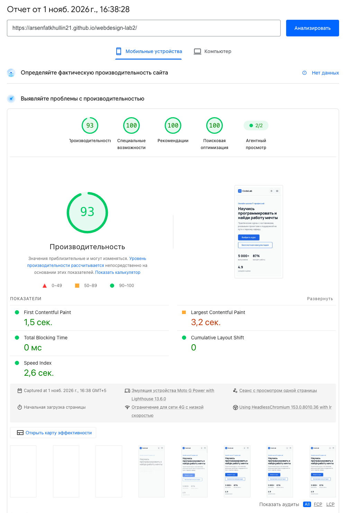{#fig:psi-bm}
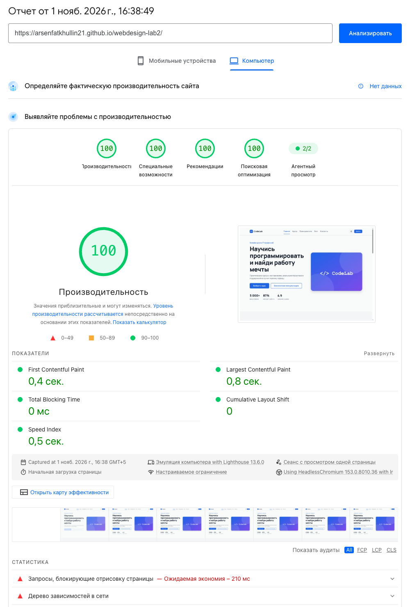{#fig:psi-bd}
:::

## 3.2. Исходное состояние: Lighthouse

Lighthouse 13.6 запускался в Chrome по опубликованному адресу для трёх ключевых страниц: «Главная», «Курсы», «Контакты».

Lighthouse предупреждает, что CPU тестового компьютера медленнее ожидаемого. Поэтому баллы локального Lighthouse используются для сравнения «до / после» в одинаковых условиях, а итоговые значения Core Web Vitals берутся из PageSpeed Insights.

::: row
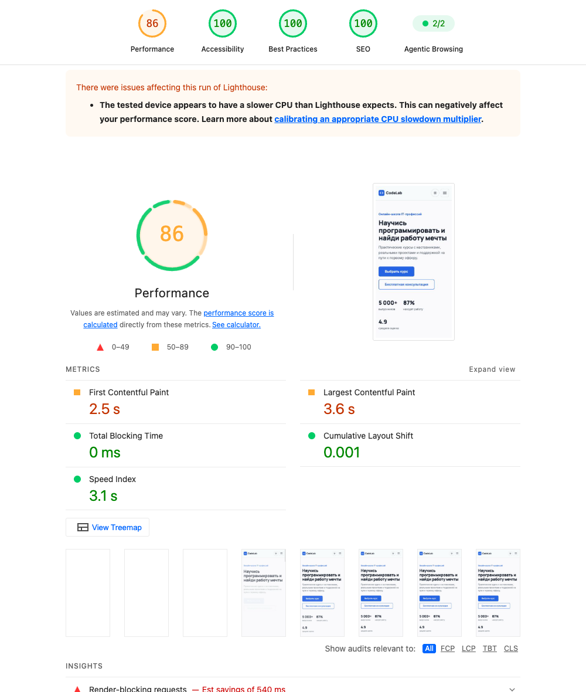{#fig:lh-bm}
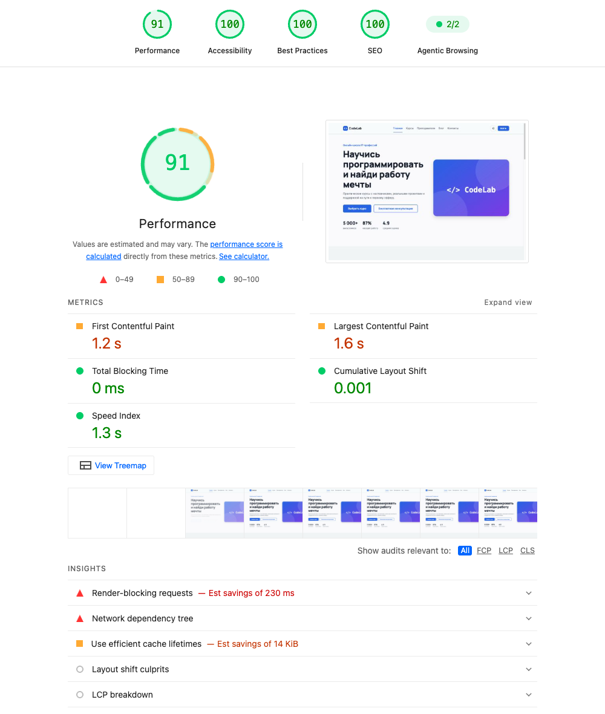{#fig:lh-bd}
:::

Аудиты, не прошедшие проверку на главной странице (Mobile), приведены в таблице @tab:failed.

Таблица: Аудиты Lighthouse, не прошедшие проверку (главная, Mobile, до оптимизации) {#tab:failed}

{{include:_gen/lh-failed.md}}

Топ-3 проблемы:

1. **Запросы, блокирующие отрисовку.** Пять отдельных CSS-файлов и стили Google Fonts; ожидаемая экономия около 540 мс.
2. **Цепочка зависимостей.** Шрифт загружается только после CSS шрифтов, а тот — после HTML: `HTML → CSS шрифтов → woff2`.
3. **Элементы первого экрана появлялись с анимацией.** Их показывал JavaScript, поэтому отрисовка LCP-элемента откладывалась. Ещё одно замечание: на странице «Курсы» нарушен порядок заголовков `h1 → h3` (Accessibility 98).

## 3.3. Диаграмма загрузки (waterfall)

Сервис webpagetest.org при запуске теста требует пройти проверку «Verify you are human» (Cloudflare) и вход в аккаунт Catchpoint. Поэтому диаграмма загрузки построена по данным Chrome: Lighthouse в режиме DevTools-throttling с теми же условиями, что и WebPageTest «Mobile 4G» — реальная задержка и пропускная способность сети, замедление CPU ×4. Диаграмма показывает время начала и окончания каждого запроса, а также моменты FCP, LCP и Load (рисунок @fig:wf-before).

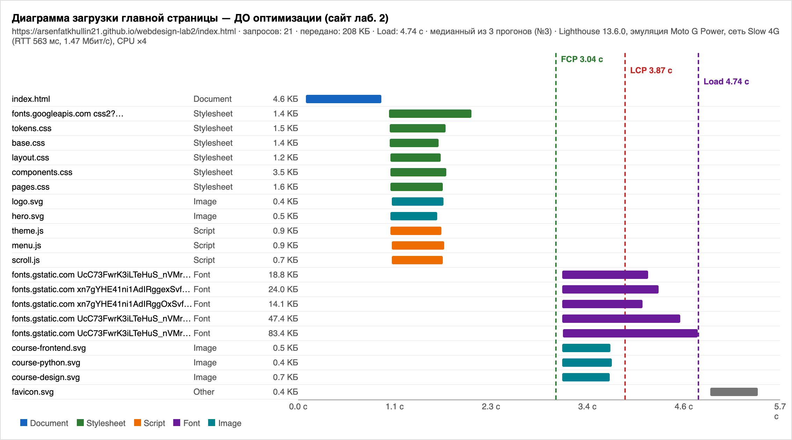{#fig:wf-before}

Сеть в этом режиме нестабильна, поэтому выполнено три прогона и показан медианный по LCP, как в WebPageTest. Значения всех прогонов приведены в таблице @tab:wf.

На диаграмме видно:

- до первой отрисовки загружаются шесть таблиц стилей: пять CSS-файлов сайта и стили Google Fonts;
- шрифты Inter и Manrope — самые тяжёлые ресурсы страницы (около 190 КБ из 208 КБ);
- шрифты запрашиваются только после первой отрисовки.

Есть и вторая находка. Между окончанием загрузки CSS и первой отрисовкой проходит около секунды, хотя сеть в это время простаивает. Аудит главного потока показывает в этом месте одну длинную задачу «Style & Layout» — около 1.1 с при замедлении CPU ×4.

## 3.4. Исправленные проблемы

Таблица: Выполненные оптимизации {#tab:fixes}

| № | Проблема | Решение | Где |
|---|---|---|---|
| 1 | 5 блокирующих CSS-запросов | CSS склеивается при сборке в один файл `css/bundle.css` | `tools/build.py` |
| 2 | Google Fonts блокируют отрисовку | `<link media="print" onload="this.media='all'">` + `<noscript>`; `preconnect`, `display=swap` | `<head>` всех страниц |
| 3 | Сдвиг текста (CLS) при подмене шрифта | fallback-шрифты с `size-adjust` и `ascent-override` под метрики Inter и Manrope | `css/tokens.css` |
| 4 | LCP-элемент появлялся с анимацией | с первого экрана убран `data-animate`; у иллюстрации `fetchpriority="high"`, `loading="eager"`, `<link rel="preload">` | `index.html` |
| 5 | Скрипты без `defer` | `defer` у всех скриптов | все страницы |
| 6 | Forced reflow в `scroll.js` | геометрия измеряется при `load`/`resize`, а не в каждом кадре | `js/scroll.js` |
| 7 | Нет кэширования статики | `_headers`: `max-age=31536000, immutable` для CSS, JS и изображений (действует на Netlify) | `_headers` |
| 8 | Порядок заголовков на «Курсы» | заголовки карточек `h3 → h2` | `tools/build.py` |

Рекомендацию сжать изображения через Squoosh в WebP проверить было не на чем. Все иллюстрации сайта — векторные SVG размером около 1 КБ, тяжелее всего на странице шрифты. Это видно на диаграмме загрузки (таблица @tab:heaviest).

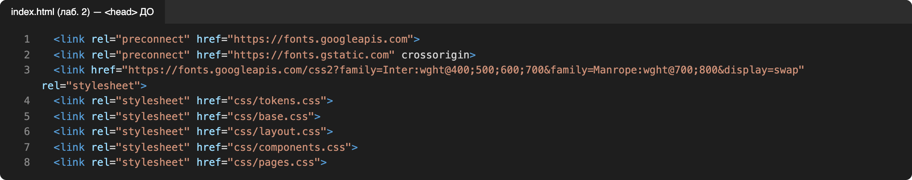{#fig:code-hb}

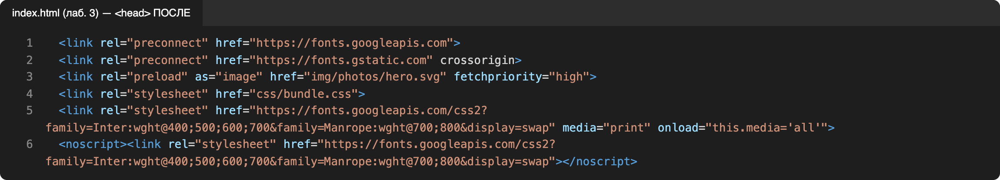{#fig:code-ha}

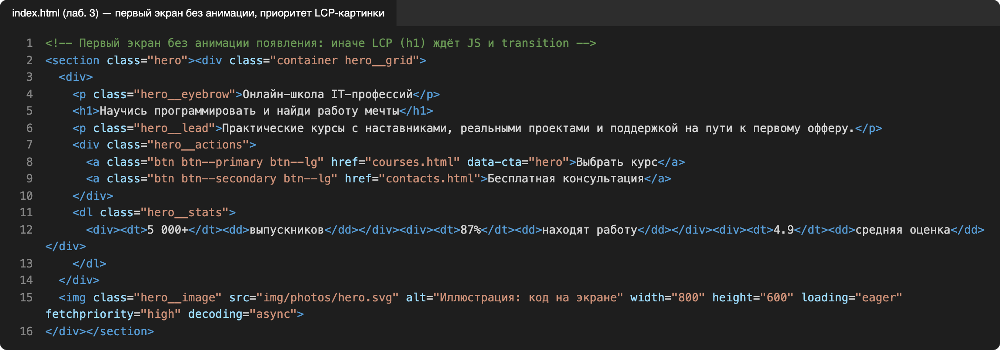{#fig:code-hero}

::: row
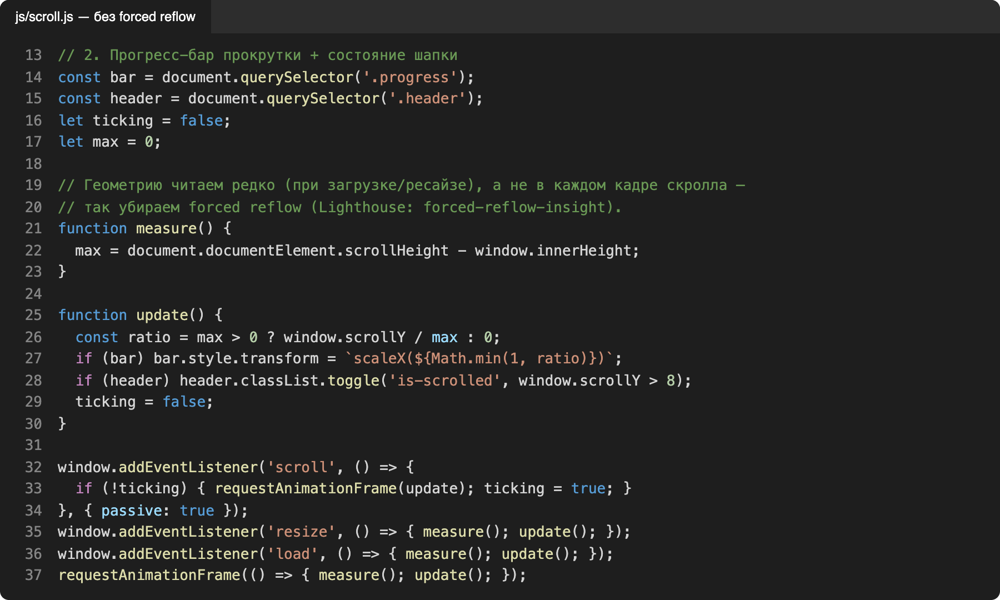{#fig:code-scroll}
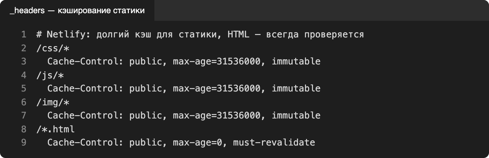{#fig:code-headers}
:::

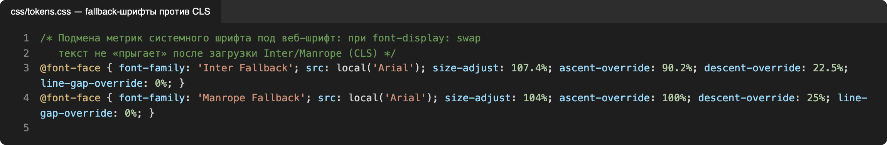{#fig:code-fonts}

## 3.5. Итерация: что показал PageSpeed после первой оптимизации

После первой итерации (исправления 1–3 и 5–8) локальный Lighthouse показывал LCP 1.5 с. PageSpeed Insights на опубликованной версии дал **Performance 93 и LCP 3.2 с** (рисунок @fig:psi-iter1).

Разбивка LCP в Lighthouse показала, что LCP-элемент — заголовок `h1`. Задержку давала не загрузка, а **отрисовка элемента (element render delay)**: заголовок был прозрачным, пока `scroll.js` (с `defer`) не добавлял класс анимации.

После исправления 4 — первый экран без анимации — LCP на мобильных снизился до 0.8 с. Это хороший пример data-driven подхода: проблему нашёл замер в условиях, близких к реальным, а не интуиция.

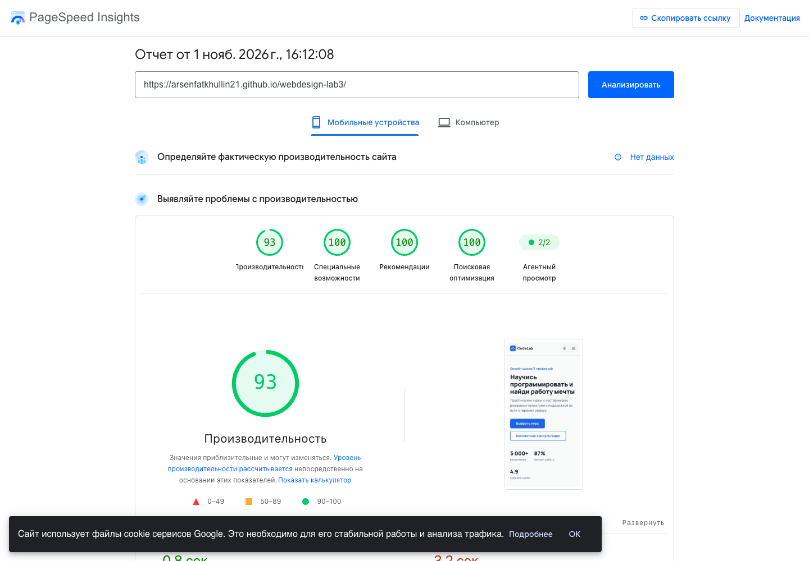{#fig:psi-iter1 width=70}

## 3.6. Результаты после оптимизации

::: row
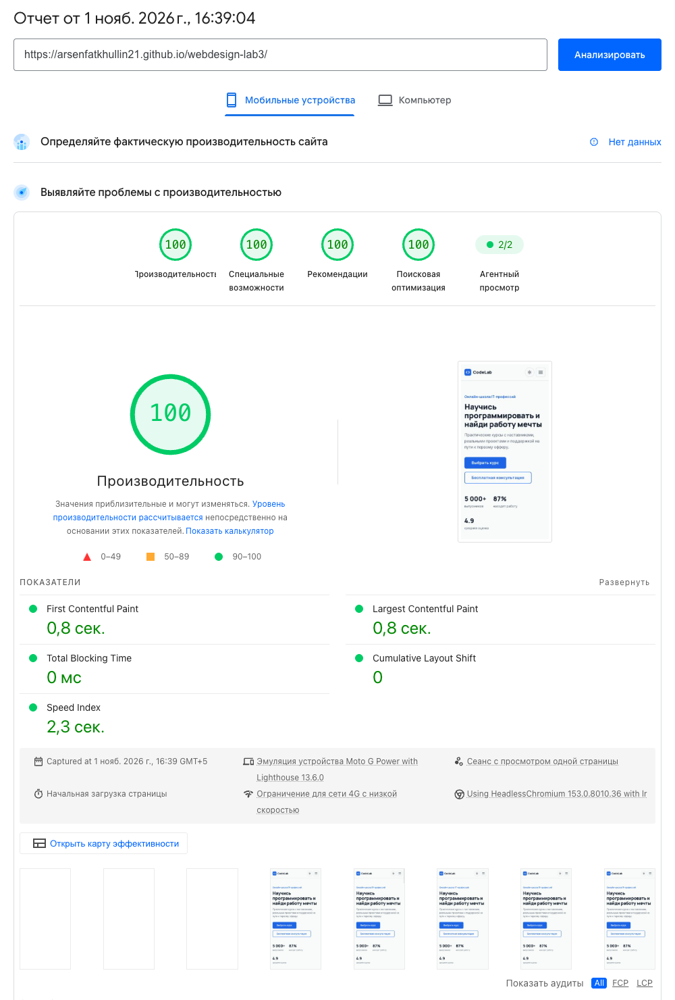{#fig:psi-am}
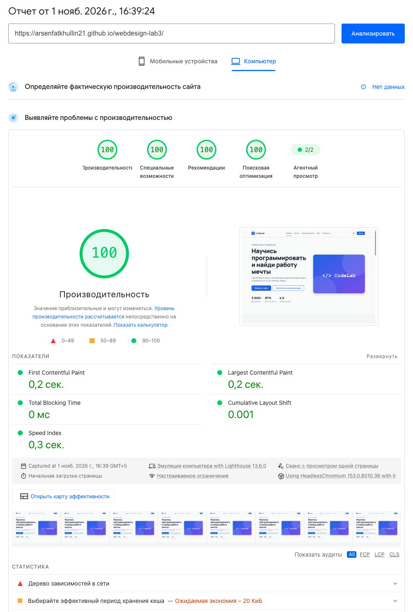{#fig:psi-ad}
:::

::: row
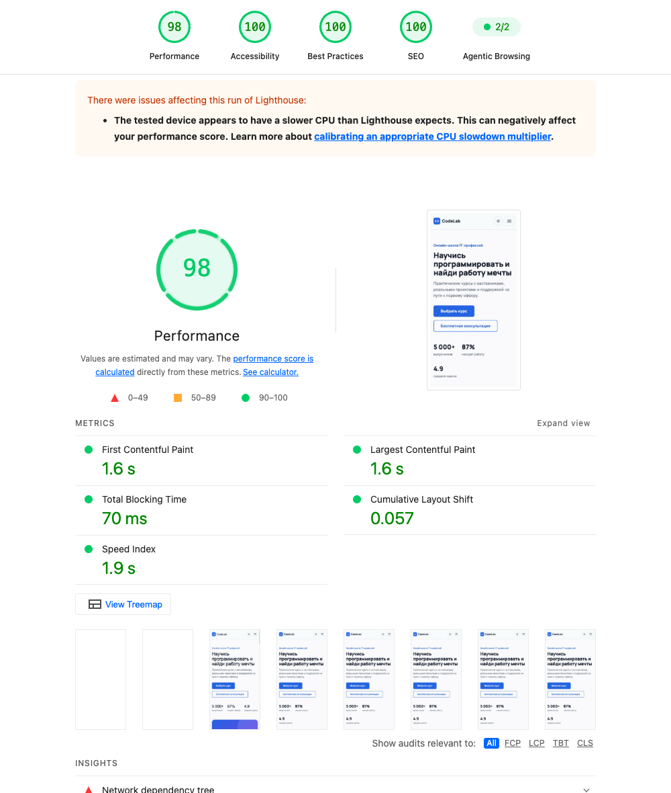{#fig:lh-am}
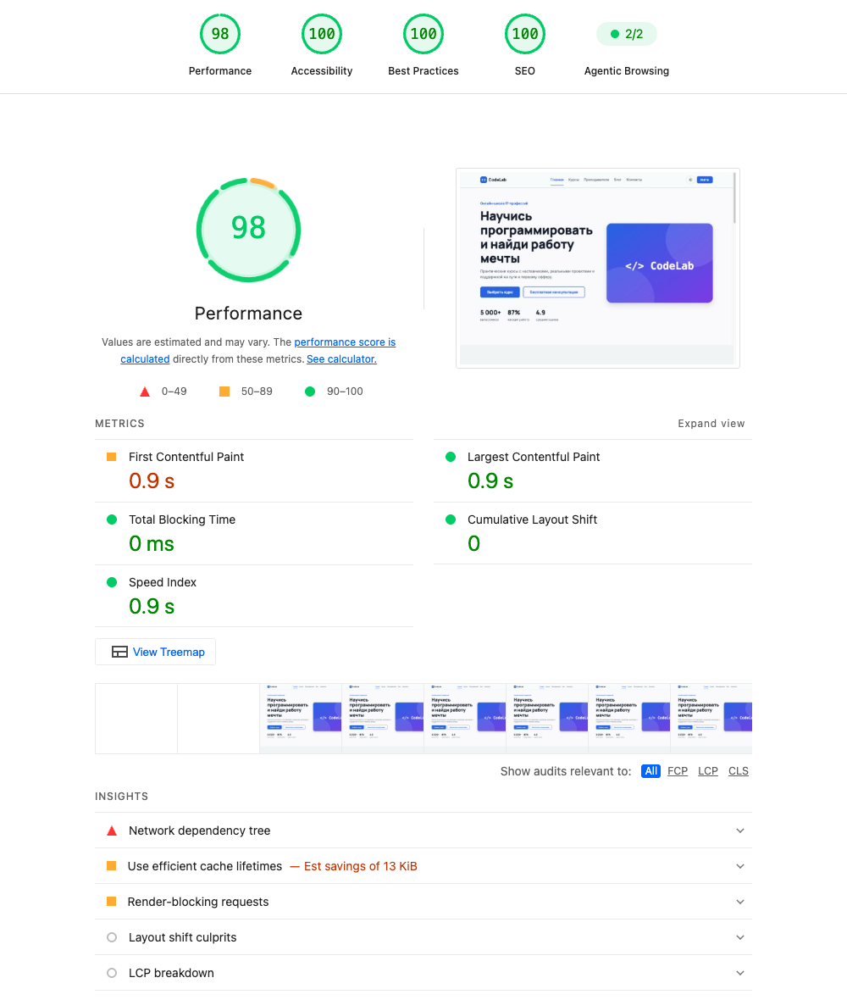{#fig:lh-ad}
:::

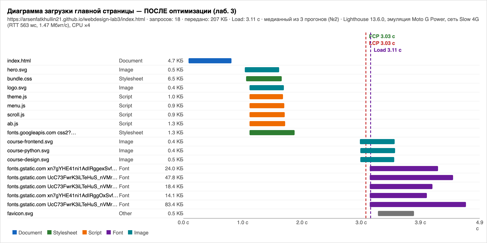{#fig:wf-after}

Таблица: PageSpeed Insights, главная страница — до и после {#tab:psi}

{{include:_gen/psi.md}}

Таблица: Lighthouse, опубликованные сайты — до (лаб. 2) и после (лаб. 3) {#tab:lh}

{{include:_gen/lighthouse.md}}

Таблица: Загрузка главной страницы в условиях Slow 4G (по диаграммам загрузки) {#tab:wf}

{{include:_gen/waterfall.md}}

Таблица: Самые тяжёлые ресурсы главной страницы после оптимизации {#tab:heaviest}

{{include:_gen/heaviest.md}}

В режиме DevTools-throttling (таблица @tab:wf) после оптимизации:

- запросов, блокирующих отрисовку, стало в шесть раз меньше;
- медианный LCP снизился с 3.9 до 3.0 с, полная загрузка — с 4.7 до 3.1 с.

FCP при этом почти не изменился. Его сдерживает длинная задача Style & Layout (около 1.1 с) — она есть в обеих версиях, и сетевыми оптимизациями её не убрать. Эта проблема вынесена в рекомендации (раздел 7). Абсолютные значения здесь выше, чем в PageSpeed Insights: задержка 562 мс добавляется к каждому запросу поверх задержки реального домашнего канала. Для сравнения «до / после» важны соотношения, а не абсолютные числа.

Цели задания выполнены:

- **LCP < 2.5 с** на всех страницах и устройствах;
- **CLS < 0.1**;
- **Lighthouse Performance и Accessibility ≥ 90**.

На мобильной главной CLS вырос с 0 до 0.057. Раньше страница ждала шрифт и рисовалась один раз. Теперь она сразу рисуется системным шрифтом и немного перестраивается после загрузки Inter. Значение остаётся в зоне «хорошо», а FCP сократился почти вдвое — это осознанный компромисс.

# 4. Microsoft Clarity

## 4.1. Подключение

Clarity подключается при сборке: код счётчика вставляется перед `</head>` на всех страницах обоих вариантов, если в репозитории задана переменная `CLARITY_ID` (Settings → Variables). Публикация выполняется автоматически через GitHub Actions (рисунки @fig:code-pages, @fig:gh-actions).

Скрипт `js/ab.js` дополнительно:

- передаёт в Clarity тег `variant` (a/b) — по нему фильтруются записи и тепловые карты;
- отправляет события `cta_click_hero`, `cta_click_footer` и `rage_click`;
- считает время до первого клика по CTA и максимальную глубину скролла.

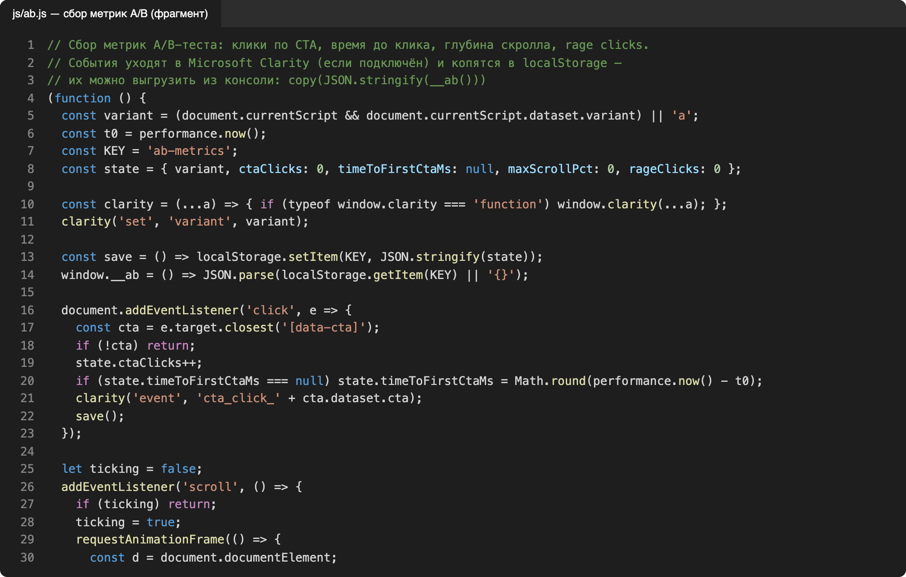{#fig:code-ab width=90}

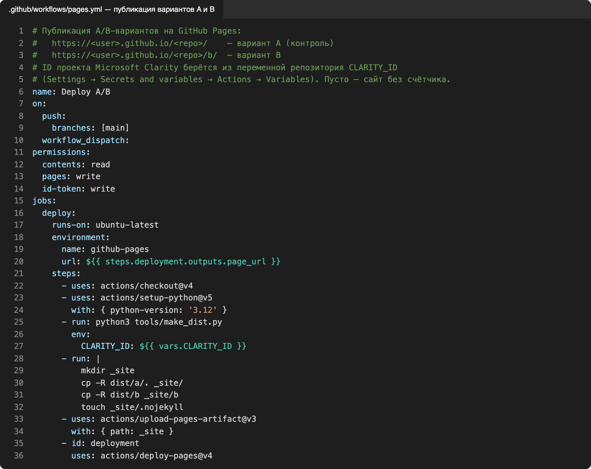{#fig:code-pages width=90}

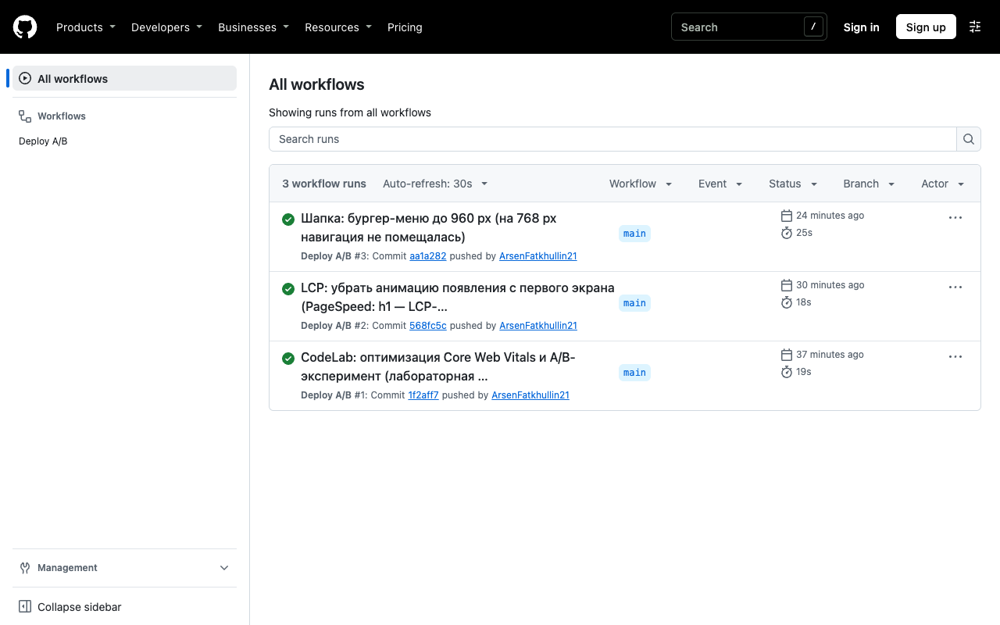{#fig:gh-actions width=85}

## 4.2. Тепловые карты и записи сессий

{#fig:cl-dash optional="скриншот Clarity → Dashboard"}

::: row
{#fig:cl-ha optional="Heatmaps → Click, главная, variant = a"}
{#fig:cl-hb optional="Heatmaps → Click, главная, variant = b"}
:::

::: row
{#fig:cl-scroll optional="Heatmaps → Scroll, главная"}
{#fig:cl-rec optional="Recordings: кадр сессии, где участник застрял"}
:::

## 4.3. Наблюдения

{{include:_gen/observations.md}}

# 5. Юзабилити-тестирование

## 5.1. Сценарии

Сессии проводились удалённо через Google Meet с демонстрацией экрана по протоколу think-aloud. Ведущий зачитывал задачи дословно и не подсказывал. Сценарий ведущего — файл `research/сценарий_модератора.md` в репозитории.

1. «Вы хотите научиться веб-дизайну. Найдите подходящий курс и оставьте заявку на обучение.»
2. «Вы ищете информацию о преподавателе. Найдите страницу с преподавателями и узнайте, какой курс ведёт один из них.»
3. «Вы хотите задать вопрос администрации. Найдите форму обратной связи и отправьте сообщение.»

## 5.2. Протокол

Таблица: Протокол юзабилити-тестирования {#tab:protocol}

{{include:_gen/protocol.md}}

Таблица: Итоги по сценариям {#tab:protocol-sum}

{{include:_gen/protocol-summary.md}}

## 5.3. SUS

После сессии каждый участник заполнял форму SUS в Google Forms: 10 утверждений, шкала 1–5. Балл каждого участника = (Σ нечётные (ответ − 1) + Σ чётные (5 − ответ)) × 2.5.

{#fig:sus-form optional="скриншот вашей Google-формы SUS (текст вопросов — research/google_forms.md)"}

Таблица: Ответы и баллы SUS по участникам {#tab:sus}

{{include:_gen/sus.md}}

{{include:_gen/sus-summary.md}}

# 6. A/B-тестирование

## 6.1. Выбор элемента и варианты

Для теста выбрана главная кнопка Hero. С неё начинается сценарий 1 (запись на курс), и к ней относятся гипотезы H2 и H3.

Таблица: Варианты A/B-теста {#tab:variants}

| Параметр | Вариант A (контроль) | Вариант B |
|---|---|---|
| Текст | «Выбрать курс» | «Начать бесплатно» |
| Цвет | синий `#2563EB` | зелёный `#15803D` (белый текст, контраст 5.0:1) |
| Расположение | Hero | Hero (без изменений) |
| Адрес | /webdesign-lab3/ | /webdesign-lab3/b/ |

Меняются две переменные — текст и цвет. Поэтому различие нельзя приписать одной из них; для чистого эксперимента их проверяют двумя последовательными тестами. Расположение не менялось, чтобы не добавлять третью переменную.

::: row
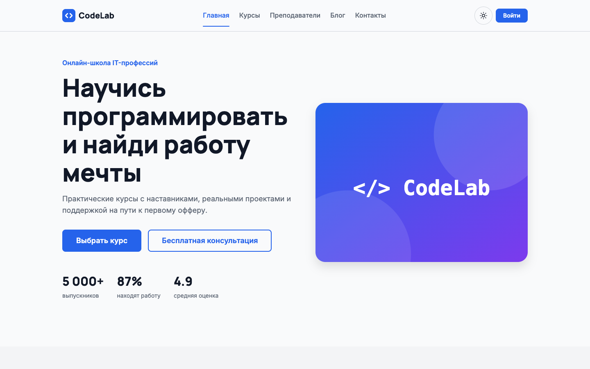{#fig:ab-ad}
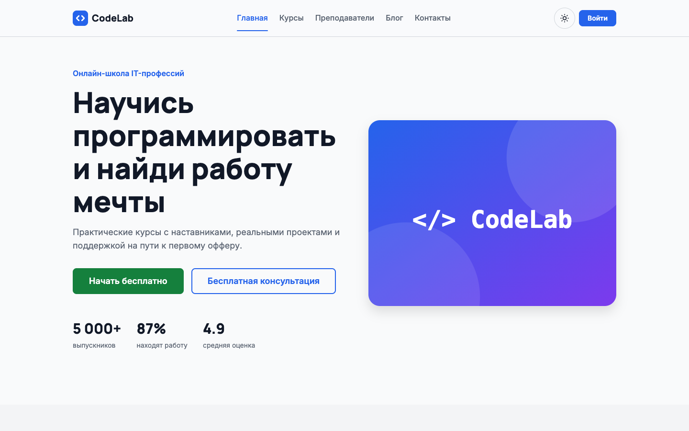{#fig:ab-bd}
:::

::: row
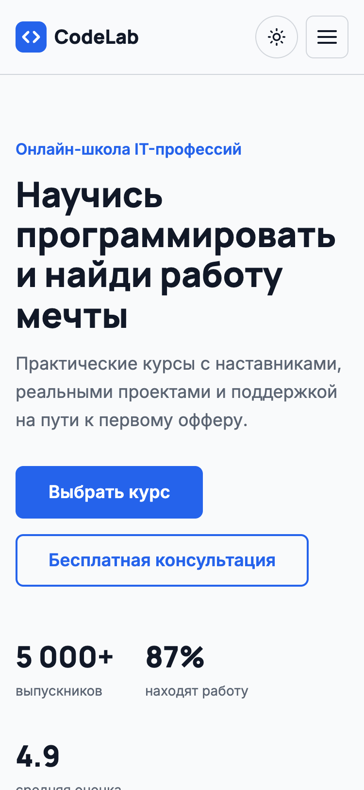{#fig:ab-am width=70}
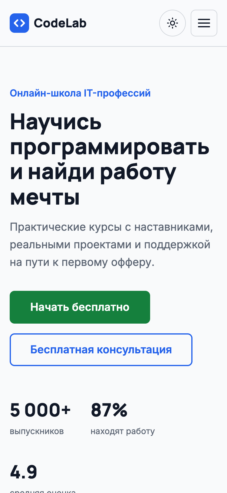{#fig:ab-bm width=70}
:::

## 6.2. Проведение

Участники распределялись по вариантам по дню рождения: чётный → A, нечётный → B. Все получали одинаковое задание: «Найди, как записаться на подходящий курс». После задания участник отвечал на вопросы формы: лёгкость поиска (1–5), какая кнопка первой привлекла внимание, SUS. Поведенческие метрики снимались через Clarity и `js/ab.js`.

{{include:_gen/ab-n.md}}

## 6.3. Результаты и статистический анализ

Для каждой метрики рассчитаны среднее и стандартное отклонение. Значимость различий проверена двусторонним t-тестом Уэлча — аналог `=T.TEST(A; B; 2; 3)` в Google Sheets. Расчёт выполняет `tools/analyze.py`; формула p-значения проверена на эталоне: t = 2, df = 10 → p = 0.0734.

Таблица: Сравнение вариантов A и B {#tab:ab}

{{include:_gen/ab.md}}

**Вывод.** {{include:_gen/ab-conclusion.md}}

При выборке меньше 50 участников результаты имеют низкую статистическую мощность. Незначимое различие не доказывает, что эффекта нет; значимое следует перепроверить на большей выборке.

# 7. Рекомендации

Проблемы приоритизированы по матрице Impact / Effort:

- высокий эффект + низкие усилия — «Делать сейчас»;
- высокий эффект + высокие усилия — «Планировать»;
- низкий эффект + низкие усилия — «Делать при случае»;
- низкий эффект + высокие усилия — «Не делать».

Таблица: Сводная таблица проблем и рекомендаций {#tab:problems}

{{include:_gen/problems.md}}

# 8. Вывод

**Гипотеза H1 подтвердилась.** LCP главной страницы на мобильных был 3.2 с по PageSpeed Insights и 3.6 с по Lighthouse — выше порога 2.5 с. Причиной была цепочка блокирующих CSS и шрифтов, а не изображения: все иллюстрации — SVG по 1 КБ. После оптимизации:

- Performance на мобильных — 100 (PageSpeed);
- LCP — 0.8 с;
- Lighthouse ≥ 96 по всем трём страницам на обоих устройствах.

**Гипотезы H2 и H3:** [[ЗАПОЛНИТЬ: подтвердились или нет — по данным Clarity, сценария 1 и A/B-теста (раздел 6.3)]].

**Самое неожиданное.** Стандартные советы методички (сжать изображения, WebP) почти ничего не дали: узкое место было в другом. Вторую причину медленного LCP — анимацию заголовка — показал только PageSpeed на опубликованной версии, а локальный Lighthouse её не выявил. Кроме того, одна оптимизация ухудшила другую метрику: CLS вырос с 0 до 0.057. Значит, после каждого изменения нужно перемерять все метрики.

**Как данные изменили восприятие дизайна.** Анимация появления, которая в лаб. 2 считалась украшением, оказалась вредной для первого экрана: она задерживала главную метрику загрузки. Решения о дизайне первого экрана теперь принимаются с учётом LCP. [[ЗАПОЛНИТЬ: добавить выводы из юзабилити-тестов и A/B своими словами]]

# 9. Ответы на контрольные вопросы

1. **Core Web Vitals** — три метрики Google: LCP (скорость загрузки главного контента), INP (отзывчивость) и CLS (визуальная стабильность). Google выделяет их, потому что они отражают реальный пользовательский опыт и учитываются в ранжировании поиска.
2. **LCP** измеряет время отрисовки самого крупного элемента первого экрана. Как улучшить: убрать блокирующие CSS и JS, дать LCP-ресурсу высокий приоритет (`preload`, `fetchpriority`), не скрывать первый экран анимацией, сжимать изображения, использовать CDN.
3. **CLS** — суммарный неожиданный сдвиг элементов при загрузке. Как избежать: задавать `width`/`height` или `aspect-ratio` у медиа, использовать `font-display` с подгонкой метрик fallback-шрифта (`size-adjust`), резервировать место под динамический контент.
4. **Lighthouse и PageSpeed Insights.** Lighthouse — лабораторный аудит в Chrome DevTools или CLI на своём компьютере. PageSpeed Insights запускает Lighthouse на серверах Google и добавляет полевые данные реальных пользователей (CrUX), если у сайта достаточно трафика.
5. **A/B-тестирование** — сравнение двух версий элемента на случайно разделённых группах пользователей по заранее выбранной метрике. Нужно, чтобы принимать решения на данных, а не на мнениях.
6. **5 участников** достаточно, чтобы выявить около 80% проблем юзабилити (Нильсен, Ландауэр).
7. **SUS** (System Usability Scale) — опросник из 10 утверждений со шкалой 1–5. Для нечётных утверждений берётся (ответ − 1), для чётных (5 − ответ); сумма умножается на 2.5. Результат — от 0 до 100, среднее по отрасли около 68.
8. **Rage clicks** — серия быстрых кликов в одном месте: признак раздражения, когда элемент не реагирует так, как ожидается. **Dead clicks** — клики, после которых ничего не происходит (например, по некликабельному тексту, похожему на ссылку).
9. **Think-aloud protocol** — участник проговаривает вслух, что видит, ищет и ожидает. Так ведущий понимает причины ошибок, а не только сам факт ошибки.
10. **Статистическая значимость** показывает, насколько вероятно, что наблюдаемое различие — случайность. Без неё можно внедрить «улучшение», которое было шумом выборки.
